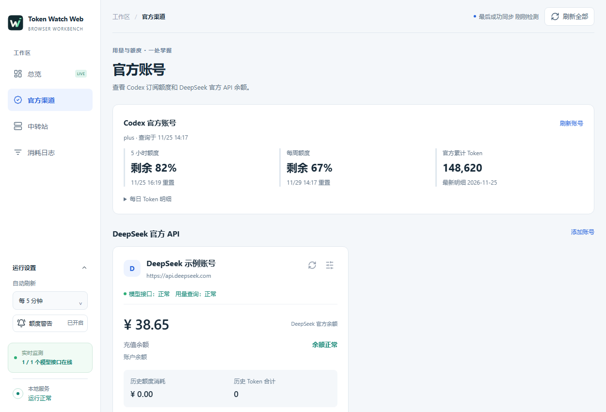

# Token Watch

Token Watch 是一个运行在本机的 AI 账号额度与 Token 用量监控工具。你可以在 Windows 桌面的悬浮球或顶部灵动岛里看 **Codex 还剩多少额度、什么时候重置、DeepSeek 还有多少余额**。使用多个 API 中转站时，切换到中转站模式就能看各站余额和连接状态。详细用量、历史记录与导出集中在 Web 工作台。



*图中使用模拟账号和余额。实际额度周期和用量明细由账号提供方返回。*

## 快速开始

以下命令适用于 Windows PowerShell。准备好 Node.js 和 npm。Web 后台需要支持 `node:sqlite` 的 Node.js，建议使用 **22.13 或更高版本**。Codex 客户端仅在监控 Codex 官方账号时需要。

在仓库首页选择 **Code → Download ZIP** 并解压，或用 Git 克隆仓库。进入包含 `package.json` 的目录，打开 PowerShell 运行：

```powershell
npm ci
.\Start-Token-Watch-Web.cmd
```

浏览器会打开 [本机工作台](http://127.0.0.1:4318/)。首次使用时，直接进「官方渠道」连接账号，或进「中转站」添加站点。首次启动时站点列表为空，你可以只连接想监控的账号。使用期间请保持 Web 启动窗口运行。

需要在桌面上看额度时，双击项目里的 **Start-Token-Watch.vbs**，也可以在项目目录运行 `npm run floating`。悬浮端会复用正在运行的本机 Web 服务，服务尚未运行时会尝试启动它。上述两个 Windows 启动文件默认使用同一个数据目录。

## 连接账号和中转站

| 我想监控 | 如何接入 | 可以看到 |
| --- | --- | --- |
| Codex 官方订阅 | 在本机 Codex 客户端使用 ChatGPT 账号登录，打开「官方渠道」，点击「刷新账号」 | 官方返回的额度周期、剩余百分比、重置时间，以及可用的累计和每日 Token |
| DeepSeek 官方 API | 在「官方渠道 → DeepSeek 官方 API → 添加账号」填写自己的 API Key，保留预填的 `https://api.deepseek.com`，保存后刷新 | 接口状态、余额、币种和可用的余额明细 |
| OpenAI 兼容中转站 | 在「中转站 → 添加中转站」填写服务商提供的 Base URL 和 API Key；也可以从本机 CC Switch 选择配置导入 | 模型连通性、可用模型、服务商支持的余额或额度计划、已记录的调用与消耗 |

**Codex 的数据从哪里来？** Token Watch 通过本机 `codex app-server` 查询当前登录账号。剩余百分比来自 `account/rateLimits/read`；「官方累计 Token」取自 `account/usage/read` 的 `summary.lifetimeTokens`。卡片同时标注最新每日明细的日期，因此可以看出官方明细更新到了哪一天。账号只返回周额度时，页面就只显示周额度。这份账号汇总独立展示，避免与本地调用日志重复累计。[Codex 采集实现](codex-account.js)

**DeepSeek 如何归类？** 使用官方 API 地址接入的普通站点会自动归入「官方渠道」。通过第三方地址调用 DeepSeek 模型的站点归入「中转站」。官方余额取自 `GET /user/balance`，沿用接口返回的币种。[渠道识别实现](public/monitor-channels.js)

**中转站需要哪些凭据？** 模型连通性使用模型 API Key。余额查询取决于服务商，有些 New API 站点还需要单独的统计令牌和用户 ID。站点编辑器支持测试连接、单独测试用量查询，以及自定义余额提取脚本。先测试再保存，便于区分模型访问和余额查询的问题。

## 悬浮球与灵动岛

| 操作 | 入口 |
| --- | --- |
| 只看官方账号 | 默认使用「官方账号」模式。紧凑视图展示额度或余额，展开后查看 Codex 重置时间和 DeepSeek 余额详情 |
| 临时查看中转站 | 展开面板点「切到中转站」，或右键选择「监控模式 → 中转站」；切回官方账号使用同一入口 |
| 换成顶部灵动岛 | 右键悬浮球或使用托盘菜单，选择「悬浮样式 → 顶部灵动岛」 |
| 打开对应网页 | 点「打开工作台」，会进入当前模式对应的官方渠道页或中转站页 |
| 找回隐藏的悬浮球 | 从系统托盘菜单选择「找回悬浮球」 |

模式和样式会在下次启动时恢复。切换模式只影响展示和手动刷新的渠道范围，后台仍按原周期采集历史数据。开机启动可在托盘菜单中单独开启。

## 工作台与记账方式

工作台有四个入口。**总览**看站点余额、历史用量和 7 天或 30 天趋势；**官方渠道**看 Codex 和 DeepSeek；**中转站**管理第三方站点、额度提醒和余额查询；**消耗日志**查看调用明细、Token 分项、额度变化和历史校正。

| 数字 | 数据来源 | 怎样理解 |
| --- | --- | --- |
| 官方剩余额度 | Codex 当前账号的额度窗口 | 百分比表示该周期还有多少可用额度，重置时间随官方数据更新 |
| 调用 Token | 本地代理响应的 `usage` 或已同步的会话用量事件 | 可按普通输入、输出、缓存读取、缓存创建查看。日志保留实际事件，手动校正单独列示 |
| 历史额度消耗 | 同一账户、币种和额度来源连续两次成功读取的余额 | 首次读取建立基线。余额从 100 降到 92，记消耗 8；充值回到 120 后，从 120 继续累计 |
| 单次调用的估算费用 | 匹配到的模型价格或手动配置的站点价格 | 用于比较调用成本。核对实际扣费时看余额变化和提供方账单；USD 与 CNY 分开统计 |

余额轮询只能看到两次读取之间的净变化。同一期间既有充值又有消费时，账本无法还原每一笔交易。已有历史总数可以在站点的「更多设置 → 历史消耗校准」补录；校正会留下时间、原值、目标值和差额。

### 把调用记入日志

- **使用本地代理。** 在站点卡片复制「客户端 Base URL」，填写到支持 OpenAI 兼容接口的客户端。地址形如 `http://127.0.0.1:4318/api/stations/<station-id>/proxy/v1`。经代理的模型请求可以留下模型、Token 和耗时；常规模型列表检查会被排除。
- **同步本机会话。** 在「消耗日志 → 调用明细」点「同步 CLI 用量」。支持 Codex CLI、Claude Code、DeepSeek Harness 和 WorkBuddy，具体取决于本机是否有可读取的会话及用量字段。可按来源应用、模型、站点或时间筛选。
- **处理陌生来源。** 出现「处理归属」提示时，可以把同名来源的历史调用映射到已有站点。只有记录、没有可用服务地址时，可以建立「幽灵中转」保存历史。
- **导出记录。** 从「中转站」导出全部已建站点的历史，或按站点、范围和记录类型导出 JSON / CSV。调用明细导出使用当前筛选范围，包含匹配的所有分页。迁移完整配置、凭据与账本时，请备份数据库。

## 启动入口与数据位置

| 入口 | 命令 | 默认行为 |
| --- | --- | --- |
| Web 工作台 | `npm run web -- --open` | 启动本地 HTTP 服务并打开浏览器，默认端口 4318 |
| 悬浮球 / 灵动岛 | `npm run floating` | 连接 Web 后台，使用同一份 Web 数据 |
| 独立桌面工作台 | `npm run app` | 打开 Electron 窗口，使用独立的桌面数据库 |
| 桌面测试模式 | `npm run app -- --test` | 使用系统临时目录下的 `token-watch-test` 配置与数据库 |

Windows 下，Web 命令默认使用 `%APPDATA%\token-watch-web`。双击 Web 启动文件或由悬浮端启动后台时，默认使用 `%USERPROFILE%\token-watch-data`。如果打算混用入口，可以先在运行命令的 PowerShell 窗口显式指定数据目录：

```powershell
$env:TOKEN_WATCH_WEB_DATA_DIR = Join-Path $env:USERPROFILE 'token-watch-data'
npm run web -- --open
```

独立桌面端默认使用 `%APPDATA%\token-usage-monitor-demo`，可用 `TOKEN_WATCH_DATA_DIR` 指定目录。Web 端可用 `TOKEN_WATCH_WEB_PORT` 改监听端口。

<details>
<summary>独立桌面端首次启动提示找不到 stations.json</summary>

当前版本的桌面 SQLite 初始化会读取种子配置。第一次从源码启动时，可在项目根目录执行以下命令。它只会在目标目录既没有数据库也没有配置时复制示例文件。

```powershell
$desktopData = if ($env:TOKEN_WATCH_DATA_DIR) { $env:TOKEN_WATCH_DATA_DIR } else { Join-Path $env:APPDATA 'token-usage-monitor-demo' }
New-Item -ItemType Directory -Path $desktopData -Force | Out-Null
$stationFile = Join-Path $desktopData 'stations.json'
if (!(Test-Path $stationFile) -and !(Test-Path (Join-Path $desktopData 'usage.db'))) {
    Copy-Item .\data\stations.json $stationFile
}
npm run app
```

桌面测试模式遇到同样提示时，将目标目录换成 `Join-Path $env:TEMP 'token-watch-test'`，然后运行 `npm run app -- --test`。

</details>

### 数据备份与隐私

设置、站点凭据、调用记录和额度账本保存在本机 SQLite 数据库 `usage.db`。备份时，先退出使用该目录的桌面端或 Web 后台，再复制整个数据目录；运行中的数据库可使用 SQLite 的备份工具。数据库和迁移前的 `stations.pre-sqlite-*.json` 可能含有 API Key，应作为私密文件保管。对外分享日志或截图前，也请检查站点名称、服务地址和用量记录。

## 常见问题

**Web 页面打不开怎么办？** 先确认启动窗口仍在运行，再打开启动日志打印的本机地址。默认地址是 [127.0.0.1:4318](http://127.0.0.1:4318/)。若提示端口占用，先检查托盘中的 Token Watch 是否已经启动了同一工作台。

**换了启动方式，为什么站点列表变空了？** 检查启动日志里的数据目录。独立桌面端和 Web 端分别保存数据；两个 Web 入口也可能使用不同的默认路径。重新指向原来的数据目录即可读取原账本。

**模型检查正常，却没有余额？** 模型列表与余额使用不同接口。打开站点编辑器，核对统计地址和所需凭据，运行「仅测试用量查询」。Codex 官方卡片显示需要登录时，则应先在本机 Codex 客户端完成 ChatGPT 登录，再点「刷新账号」。

## 开发、测试与打包

```powershell
npm ci
npm test
npm run dist:win
```

`npm test` 运行 Node.js 的单元和集成测试。`dist:win` 用于构建 Windows x64 独立桌面工作台，在 `dist\` 输出 NSIS 安装版和便携版。悬浮球与灵动岛使用前面的源码启动入口。

要了解实现，可从 [服务与代理](server.js)、[SQLite 存储](usage-store.js)、[官方账号查询](codex-account.js) 和 [悬浮窗口](floating-main.js) 入手。
